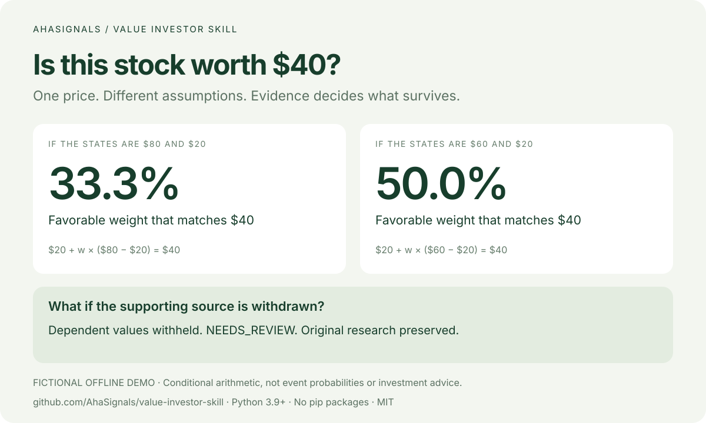

# value-investor-skill

[English](README.md) · [简体中文](README.zh-CN.md) · [日本語](README.ja.md) · [한국어](README.ko.md) · [Deutsch](README.de.md) · [Français](README.fr.md) · [Español](README.es.md)

## 미국 주식 이름이나 티커만 입력하세요

전체 스킬과 Python, 인터넷을 사용할 수 있는 환경에서는 SEC 재무자료와 공개 과거 주가를 자동으로 가져옵니다. JSON 작성이나 API 키가 필요 없습니다. 일반 채팅은 앱의 검색 기능에 따라 달라집니다.

```bash
python3 scripts/investor.py research Microsoft --out output/msft
```

`output/msft/research.html` · [Microsoft](docs/msft-research.md) · [Sources / replay](references/us-research.md)

미국 비금융 사업회사를 우선 지원하며 누락값은 알 수 없음으로 남깁니다. 실제 Microsoft의 고정 재무 데이터로 오프라인 재현도 가능합니다.


## 이 주식은 지금 가격만큼의 가치가 있을까요?

기업의 사업을 살펴보고, 가치평가의 가정을 점검하고, 현재 주가가 성립하려면 무엇이 필요한지 확인하세요. **[AhaSignals](https://ahasignals.com/methodology/?utm_source=github&utm_medium=readme&utm_campaign=value_investor_launch_2026_11&utm_content=ko_methodology)** 가 공개한 AI 어시스턴트용 투자 리서치 스킬입니다.

[브라우저에서 데모 체험](https://ahasignals.com/value-investor-skill/?utm_source=github&utm_medium=readme&utm_campaign=value_investor_launch_2026_11&utm_content=ko_demo) · [변경 전후 사례](docs/demo.md) · [MIT 라이선스](LICENSE)

**스킬 1개에 연구 흐름 8개. 가상 사례 3개, 데모 그림 4개, 챗봇 진입 경로 6개, 7개 언어 안내와 HTML·Markdown·JSON 출력을 제공합니다.**

### 재무제표, 과거 PER, 가격 흐름 살펴보기

| 연구 | 확인할 내용 |
| --- | --- |
| 재무제표 | 연간 매출 성장, 이익률, 이익 대비 영업현금흐름, 설비투자 후 현금, 순차입금, 주식 수 증가 |
| 과거 PER | 과거 월별 평균·중앙값·백분위. 적자나 비교 불가능한 사업 환경에서는 비교 보류 |
| 가격 배경 | 일별 OHLC, 50·200개 관측값 이동평균, 낙폭. 반등 예측이 아닙니다 |

기존 사업 분석, 가치평가 시나리오, 가격의 전제, 반증, 증거 갱신을 합쳐 8개 흐름입니다. 가상 제조업체의 PER은 10배로 과거 중앙값 20배보다 낮습니다. 하지만 순이익 1,500만, 영업현금흐름 500만, 설비투자 800만으로 차액은 마이너스 300만입니다. 순차입금과 주식 수도 늘었습니다. 낮은 PER의 이유부터 확인해야 합니다.

> [회사]의 연차보고서를 바탕으로 이익이 현금으로 이어지는지, 낮은 PER이 사업 변화를 반영하는지 조사해 주세요. 일별 가격은 배경으로 활용하고, 가장 강한 반증과 다음에 확인할 자료를 알려 주세요. 출처와 날짜를 표시하고 없는 수치는 채우지 마세요.

```bash
python3 scripts/investor.py scan-demo --out output/value-trap
```

`output/value-trap/scan.html`에서 차트 3개와 조사할 질문을 확인합니다. 실제 자료는 어시스턴트가 공시와 사용 가능한 가격 데이터에서 정리해 `scan` 또는 `scan-batch`에 전달합니다. 전 시장 자동 수집이나 임의 PDF 자동 분석 기능은 아닙니다. [입력 형식](references/scan-input.md) · [평균 회귀 검토 방법](references/scanning.md). 과거 평균 PER은 적정 가치가 아닙니다. 회귀를 설명할 경제적 원인과 가설을 뒤집을 증거가 필요합니다. 은행·보험·리츠에는 다른 회계 지표가 필요합니다.



### Claude · GPT · DeepSeek · Grok · Gemini · Kimi에서 시작하기

Claude, ChatGPT, DeepSeek, Grok, Gemini, Kimi 채팅에서는 [복사해서 쓰는 연구 지침](prompts/START_HERE.md)을 붙여 넣고 한국어로 답해 달라고 요청하세요. 터미널이 필요 없습니다. Claude Code 플러그인과 Codex 로컬 스킬도 제공합니다. [앱별 설치 안내](docs/hosts.md). 실행 가능한 도구는 사용하는 앱에 따라 다릅니다.

### 1분 만에 실행

Python 3.9 이상이 필요합니다. 이 **가상의 오프라인 데모**에는 pip 패키지, API 키, 유료 시장 데이터 또는 AI 모델 호출이 필요하지 않습니다.

```bash
git clone https://github.com/AhaSignals/value-investor-skill.git
cd value-investor-skill
python3 scripts/investor.py demo --out output/demo
```

`output/demo/before/research.html`과 `output/demo/after/research.html`을 열어 비교하세요. Windows에서는 `python3` 대신 `py -3`을 사용할 수 있습니다. 다시 실행할 때는 새 출력 폴더를 지정하세요. 기존 연구 기록을 덮어쓰지 않습니다.

### 스킬 설치

```bash
python3 scripts/install.py --host codex
# Claude Code:
python3 scripts/install.py --host claude
```

어시스턴트의 스킬을 다시 불러온 뒤 다음과 같이 요청하세요.

> value-investor-skill로 이 기업을 1차 자료부터 조사해 주세요. 현재 주가를 정당화하는 가정, 그 가정을 뒷받침하는 근거, 판단을 바꿀 반대 근거를 한국어로 설명해 주세요. 없는 데이터는 추측해서 채우지 마세요.

어시스턴트에는 자료 접근 권한이나 사용자가 제공한 문서가 필요합니다. AI 호스트와 데이터 서비스의 비용 및 이용 조건은 별도로 적용됩니다. 설치 프로그램은 기존 설치를 덮어쓰지 않습니다.

### 40달러 주가는 무엇을 전제로 할까요?

아래 값은 가상의 주당 현재가치 가정입니다.

| 유리한 시나리오 | 불리한 시나리오 | 40달러와 일치하는 유리한 시나리오의 가중치 |
| ---: | ---: | ---: |
| 80달러 | 20달러 | 33.3% |
| 60달러 | 20달러 | 50.0% |

각 행은 별도의 두 상태 계산입니다. **이 가중치는 사건의 성공 확률이나 신뢰구간이 아닙니다.** 80달러와 60달러 중 어느 가정을 자료가 뒷받침하는지가 다음 연구 질문입니다.

데모에서 출시 시점의 근거를 철회하면, 이에 의존하는 평가가 `NEEDS_REVIEW`로 바뀌고 새 수치의 출력을 보류합니다. 이전 연구와 영향을 받지 않는 시나리오는 유지됩니다.

### AhaSignals의 연구 방식

- 원하는 결론에 맞춰 기업가치를 역산하지 않고, 시나리오의 경제적 가정과 주가를 분리합니다.
- 자료의 공개 시각과 실제 관측 시각을 구분하고, 각 평가가 어떤 근거에 의존하는지 기록합니다.
- 현금, 부채, 미래 비용, 신규 자금과 주식 희석을 주당 가치에 함께 반영합니다.
- 변경 사항은 새 버전으로 추가하여 과거 판단을 보존합니다.
- 검증된 확률을 추정하지 못하면 `NOT_ESTIMATED`, 투자 판단 제시는 `NO_QUOTE`로 표시합니다.

현재 버전은 시나리오 계산과 연구 기록을 제공합니다. 자동 전 종목 분석, 검증된 예측 확률, 개인별 투자 조언 또는 거래 실행 기능은 제공하지 않습니다. 자료의 날짜는 입력된 메타데이터이며 내용의 진실성을 자동으로 인증하지 않습니다.

### 더 살펴보기

[입력 규격](references/input-contract.md) · [연구 절차](references/research-protocol.md) · [AhaSignals의 자료와 수정 기록](https://ahasignals.com/methodology/?utm_source=github&utm_medium=readme&utm_campaign=value_investor_launch_2026_11&utm_content=ko_methodology) · [번역 오류 신고](https://github.com/AhaSignals/value-investor-skill/issues)

한국어 문서는 시작 안내입니다. CLI, 생성 보고서와 상세 규격은 영어이며, AI 답변 언어는 사용하는 호스트에 따라 달라집니다. 번역 검토를 환영합니다.

AhaSignals는 독립 연구 발행자입니다. 연구·교육용이며 투자 또는 매매 조언이 아닙니다. 제3자 이름은 출처·호환성 설명에만 사용하며 제휴나 보증을 뜻하지 않습니다. 코드와 자체 제작한 가상 데이터는 MIT 라이선스이며, 제3자 자료의 재배포 권리는 포함하지 않습니다.
