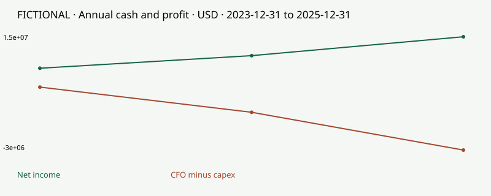

# value-investor-skill

[English](README.md) · [简体中文](README.zh-CN.md) · [日本語](README.ja.md) · [한국어](README.ko.md) · [Deutsch](README.de.md) · [Français](README.fr.md) · [Español](README.es.md)

## Is this stock worth its price?

**8 value-investing workflows in 1 AI skill: scan financial statements, compare historical P/E, inspect price trends, understand the business, test valuations, check price assumptions, challenge your thesis, and track evidence changes.**

For Claude, ChatGPT (GPT), DeepSeek, Grok, Gemini and Kimi. Start with a company name or a question. Copy the instructions into chat with no installation, or install the full skill for local Python calculations and saved research.

**6 chat assistants · 7 language guides · 3 fictional case studies · 4 demo illustrations · HTML, Markdown and JSON reports.**

**Free, MIT, no project signup.** Your AI service's account, tool access and fees still apply.

[Try the 30-second browser demo](https://ahasignals.com/value-investor-skill/?utm_source=github&utm_medium=readme&utm_campaign=value_investor_launch_2026_11&utm_content=en_demo) · [Choose your assistant](docs/hosts.md) · [中文](README.zh-CN.md) · [By AhaSignals](https://ahasignals.com)

## Start with the assistant you already use

| You use | Start here |
| --- | --- |
| **Claude, ChatGPT, DeepSeek, Grok, Gemini or Kimi chat** | Copy [these ready-to-paste instructions](prompts/START_HERE.md), then ask about a company. No terminal needed. |
| **Claude with Skills enabled** | Upload the [skill ZIP](https://github.com/AhaSignals/value-investor-skill/releases/download/v0.4.0/value-investor-skill-upload-v0.4.0.zip). [Steps](docs/hosts.md#claude-web--desktop-upload). |
| **Claude Code** | Run the two plugin commands below. |
| **Gemini CLI or Kimi Code** | Install the same skill with `--host gemini` or `--host kimi`. [Steps](docs/hosts.md#gemini-cli-and-kimi-code). |
| **GPT in Codex** | Ask it to install this repository as a skill. [Steps](docs/hosts.md#gpt--codex-local-skill). |
| **DeepSeek in a skill-capable app** | Use the Claude Code or Codex route for your configured host. [Steps](docs/hosts.md#deepseek-chat-or-a-configured-skill-host). |

In Claude Code:

```text
/plugin marketplace add AhaSignals/value-investor-skill
/plugin install value-investor@value-investor-skill
```

Then ask:

> Show me the fictional $40 example. Change one valuation assumption, then withdraw its supporting evidence. Explain what changes and why.

For your own research:

> Research [company]. How does it make money, what does its price assume, and what evidence would change the answer?

The assistant supplies reasoning and source access. Python calculates supplied scenarios and preserves revisions when execution and writable files are available. Ordinary chat uses the same research method without promising a persistent ledger. [Capabilities and troubleshooting](docs/hosts.md).


<details>
<summary>Prefer a terminal? Run the full offline demo in one minute.</summary>

Python 3.9+; no pip packages, API key or model calls for the fictional demo.

```bash
git clone https://github.com/AhaSignals/value-investor-skill.git
cd value-investor-skill
python3 scripts/doctor.py
python3 scripts/investor.py demo --out output/first-demo
```

Open `output/first-demo/before/research.html`, then `output/first-demo/after/research.html`. Use a new output directory to rerun. Windows: use `py -3` instead of `python3`.

Install a copied skill with `python3 scripts/install.py --host codex` or `--host claude`; use `--scope project --project ./my-project` for one project. The installer preserves existing copies.

You can also use `npx skills add AhaSignals/value-investor-skill --skill value-investor-skill` with the [skills CLI](https://github.com/vercel-labs/skills) (Node.js 22.20+). Choose one installation route; `DISABLE_TELEMETRY=1` opts out of that CLI's telemetry.

</details>

## Try it in two minutes

1. [Copy the research instructions](https://ahasignals.com/value-investor-skill/?utm_source=github&utm_medium=readme&utm_campaign=value_investor_launch_2026_11&utm_content=try_chat#start). Choose your chat app and language.
2. Ask for the fictional USD 40 example. Then ask it to withdraw the evidence.
3. [Check the expected result](docs/compatibility.md#two-minute-acceptance-check), or [report where you got stuck](https://github.com/AhaSignals/value-investor-skill/issues/new?template=experience.yml).

## Eight questions, inspectable answers

| Ask | Get |
| --- | --- |
| **How does this company make money?** | A business brief, funding needs and the event that could change value. |
| **What could it be worth?** | Explicit scenarios with cash, debt, costs and dilution. |
| **What does the price already assume?** | Price-matching assumptions, with underidentification made visible. |
| **What am I missing?** | Counterevidence, missing inputs and reasons to withhold conclusions. |
| **What changed since last time?** | New evidence, affected estimates and preserved prior versions. |
| **Do profits turn into cash?** | Annual cash conversion, CFO minus capex, net debt and share dilution. |
| **Is this P/E low for a reason?** | Prior-month mean, median and percentile, with loss years and noncomparable regimes withheld. |
| **What does the price history add?** | Daily OHLC checks, 50/200-observation averages and drawdowns; context for research. |

The business analysis and source judgments are performed by your AI assistant/researcher. The CLI does not independently discover a company's intrinsic value or generate a validated probability. Read the [research protocol](references/research-protocol.md).

## What is included?

| Item | Included in this repository |
| --- | --- |
| **1 installable skill** | One root `SKILL.md` with eight research workflows, including financial statements, valuation history and price context. |
| **3 fictional case studies** | A clinical-stage company with a source-withdrawal revision, a fixed-cash merger, and a low-P/E manufacturer with deteriorating cash generation. [Run the cases](docs/demo.md). |
| **4 demo illustrations** | The USD 40 example (SVG/PNG count once), plus [cash versus profit](assets/cash-vs-profit.svg), [P/E history](assets/pe-history.svg) and [price context](assets/price-context.svg). |
| **3 report formats** | Local HTML and Markdown research reports, plus structured JSON output. |
| **6 chat assistants** | Claude, ChatGPT, DeepSeek, Grok, Gemini and Kimi via portable instructions; available tools depend on the host. [Routes and verification](docs/hosts.md). |
| **7 language guides** | English, Chinese, Japanese, Korean, German, French and Spanish. Copy-ready prompts are English/Chinese; generated CLI reports are English. |

The local engine calculates supplied scenarios, checks source cutoffs and preserves SQLite research versions. Use it for fundamental stock analysis, valuation scenarios and investment-thesis review.

## A low P/E. A reason to look closer.

The fictional manufacturer trades at **10× earnings versus a prior-month median of 20×**. But annual profit is 15 million, operating cash flow is 5 million, and capex is 8 million: **CFO minus capex is negative 3 million**. Net debt and diluted shares have increased. The screen asks whether the discount reflects temporary investment or lasting deterioration.



Ask in your existing chat:

> Research [company] using its annual reports. Do profits turn into cash? Is its P/E low because the business changed? Use daily prices as context, then give the strongest counterevidence and the next filing to check. Show sources and leave missing data unknown.

Or run the complete offline case:

```bash
python3 scripts/investor.py scan-demo --out output/value-trap
```

Open `output/value-trap/scan.html`: three charts, dated measurements, excluded evidence and next research questions. To scan your own company or a supplied watchlist, the assistant can assemble reviewed data from filings and permitted price exports:

```bash
python3 scripts/investor.py scan company.json --out output/company
python3 scripts/investor.py scan-batch watchlist.json --out output/watchlist
```

The CLI screens **supplied normalized data**; it does not fetch the whole market or automatically parse arbitrary PDFs. Chat uses the same questions; executable reports require Python and files. [Input format](references/scan-input.md) · [Method and mean-reversion limits](references/scanning.md).

Historical P/E is a comparison, not fair value. Moving averages are price context, not reversal forecasts. A mean-reversion thesis needs a business mechanism, a comparable regime and evidence that could prove it wrong. Banks, insurers and property trusts require different accounting screens.

## The $40 example

*Fictional inputs. Values are assumed present values per share.*

| Favorable value | Unfavorable value | Favorable weight that matches $40 |
| ---: | ---: | ---: |
| $80 | $20 | 33.3% |
| $60 | $20 | 50.0% |

**Which evidence supports $80 rather than $60?** That is the next research question.

These are separate two-state calculations, not event probabilities or a confidence interval. One share price can fit multiple assumptions. When the source supporting launch timing is withdrawn, the demo marks both dependent favorable estimates `NEEDS_REVIEW`, preserves the old version, and withholds a new number. [See the full before/after example](docs/demo.md).

## Try these questions

- “Research this company from primary sources. What must be true for today’s price to make sense?”
- “Here is my investment thesis. Find the strongest evidence against it.”
- “This filing changed. Compare it with my saved research and show which assumptions need review.”

Your assistant needs source access or documents you provide. Missing evidence stays missing.

## What AhaSignals adds

- **Price and evidence stay separate.** Changing the price does not change the supplied state economics. The research instructions prohibit using price to manufacture a desired probability.
- **Time belongs to the evidence.** Publication and observation timestamps are distinct. Future or withdrawn evidence blocks dependent estimates.
- **Financing has two sides.** New capital and new shares enter the same per-share calculation.
- **Updates leave a record.** SQLite snapshots bind inputs, outputs and source events; revisions do not overwrite earlier judgments.
- **Unknown stays unknown.** The engine does not estimate calibrated probabilities or an executable valuation gap. It returns `NOT_ESTIMATED` / `NO_QUOTE` alongside useful scenario arithmetic.

These are verifiable design choices, not claims of superior investment performance or claims that all other research tools lack them.

## Use your own research

Start from a bundled JSON example, replace every fictional input with reviewed evidence/assumptions, set `fictional` to `false`, and supply real source URLs. Preserve explicit unknowns. Do not copy example values into a real company analysis.

```bash
python3 scripts/investor.py analyze my-research.json --out output/my-review
python3 scripts/investor.py freeze my-research.json --db output/my-ledger.sqlite
python3 scripts/investor.py verify --db output/my-ledger.sqlite
```

[Full contract, commands and revision workflow →](references/input-contract.md)

An optional [SEC helper](scripts/fetch_sec.py) discovers recent filing references by CIK and acceptance-time cutoff. It requires a caller identifier, makes an explicit network request, and does not retrieve every historical filing or calculate a valuation.

## Scope and limits

**Available:** installable skill; deterministic equity-to-per-share scenarios; conditional two-state inversion; source-date/dependency checks; append-only local snapshots; revision comparison; offline HTML/Markdown/JSON reports; fictional clinical and merger demos; optional SEC filing-index discovery.

**Not claimed:** a calibrated clinical model, automated whole-market research, a complete DCF engine, a statistical value distribution from uncalibrated scenarios, portfolio advice, continuous alerts, brokerage execution, or validated alpha. Clinical and cash-merger research have specific checklists; other companies require a suitable user-supplied model.

Declared source metadata is not authenticated fact. Historical evidence filtering cannot remove an LLM's pretraining knowledge. Local hashes detect inconsistency but do not make a database administrator-proof. Source redistribution rights remain separate from the software license.

## Verify and contribute

```bash
python3 -m unittest discover -s tests -v
python3 scripts/check_public_identity.py
python3 scripts/package_release.py --out dist
```

The tests cover arithmetic, dilution, source cutoffs, price freshness, invalidation, concurrent-version conflicts, duplicate events, restart recovery, tampering detection and clean copied installations. They do not measure investment returns. [Contributing](CONTRIBUTING.md) · [Security](SECURITY.md) · [Changelog](CHANGELOG.md)

If you try it, an issue with a reproducible redacted case is more useful than a screenshot of a target price. Do not post private holdings, credentials or licensed source documents.

AhaSignals is an independent research publisher. Research and education only; not investment, trading, legal, tax or medical advice. Third-party names identify factual sources or compatibility context, not affiliation or endorsement. MIT-licensed code and original fictional fixtures; third-party source rights are not granted by this license.

## Contributors

<table>
  <tr>
    <td align="center"><a href="https://github.com/AhaSignals"><br />AhaSignals</a><br /><sub>Maintainer and publisher</sub></td>
    <td align="center"><a href="https://chatgpt.com/"><br />ChatGPT / Codex</a><br /><sub>AI-assisted development</sub></td>
  </tr>
</table>

Development was assisted by OpenAI's Codex. AhaSignals maintains and publishes the project. The OpenAI logo identifies the tool used; it belongs to OpenAI and does not imply affiliation or endorsement.

## Continue with AhaSignals

[Read a source-dated cash-flow case](https://ahasignals.com/research/rebalance-cash-review/?utm_source=github&utm_medium=readme&utm_campaign=value_investor_launch_2026_11&utm_content=en_case) or [inspect how source clocks and revisions work](https://ahasignals.com/methodology/?utm_source=github&utm_medium=readme&utm_campaign=value_investor_launch_2026_11&utm_content=en_methodology). The open-source skill works independently; no AhaSignals account or automatic research upload.

[Language coverage and translation contributions](docs/translations.md).
